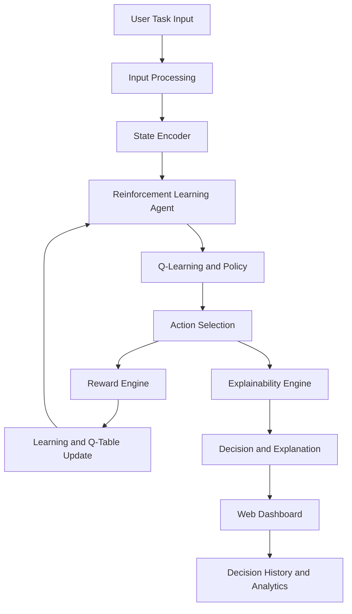

# E.A.D.A. - Explainable Adaptive Decision Agent

### Explainable Reinforcement Learning for Intelligent Task Prioritization and Smart Resource Management

E.A.D.A. (Explainable Adaptive Decision Agent) is an intelligent task prioritization and decision-support system that uses **Reinforcement Learning (Q-Learning)** to make adaptive decisions about tasks and resource allocation.

The system evaluates task information, learns from rewards and feedback, and recommends suitable actions such as executing a task immediately, allocating additional resources, splitting a task into smaller tasks, or delaying execution.

Unlike traditional task management systems that rely mainly on predefined rules, E.A.D.A. uses a learning-based decision-making approach. It also includes an Explainability Engine that provides understandable reasons behind its recommendations.

The project combines machine learning, reinforcement learning, explainable decision-making, and a web-based dashboard to demonstrate how an intelligent agent can support better task management.

---

## Project Overview

The main goal of E.A.D.A. is to develop an adaptive decision-making agent that can:

- Analyse task information and identify task requirements.
- Prioritize tasks based on their current state.
- Learn suitable decisions using Q-Learning.
- Recommend actions based on the learned policy.
- Explain why a particular decision was selected.
- Evaluate decisions using rewards, risks, and performance metrics.
- Improve its decision-making behaviour through training.

The application provides a web-based interface where users can interact with the decision agent, view recommendations, monitor training performance, and explore decision history.

---

## Problem Statement

Managing multiple tasks with limited time and resources can be challenging. Traditional task management systems often depend on fixed rules and manual prioritization, which may not adapt effectively when task conditions change.

E.A.D.A. addresses this problem by using Reinforcement Learning to learn task prioritization strategies and recommend suitable actions. Its explainability component helps users understand the reasoning behind each recommendation instead of receiving only an unexplained result.

---

## Project Objectives

1. Develop an intelligent agent using Q-Learning.
2. Encode task information into suitable states for decision-making.
3. Design a reward mechanism to evaluate the quality of decisions.
4. Implement an adaptive policy for selecting appropriate actions.
5. Provide explanations for the agent's decisions.
6. Build a web dashboard to interact with and monitor the system.
7. Analyse learning performance using training metrics and visualisations.


## Key Features

### 1. Intelligent Task Prioritization
- Analyses task information to support intelligent prioritization.
- Uses the current task state to select an appropriate action.
- Adapts its decisions using Reinforcement Learning.

### 2. Q-Learning Based Decision Agent
- Implements the Q-Learning algorithm.
- Uses an epsilon-greedy strategy for action selection.
- Maintains a Q-table to learn the value of different actions in different states.
- Updates its knowledge based on rewards received during training.

### 3. Adaptive Decision Making

The agent can recommend four types of actions:

| Action | Description |
|---|---|
| Execute Immediately | Recommends executing the task without unnecessary delay. |
| Allocate Resources | Recommends assigning additional resources to support task completion. |
| Split Task | Recommends dividing a task into smaller, manageable tasks. |
| Delay Task | Recommends postponing a task when immediate execution is not suitable. |

### 4. Explainable Decision Engine
- Provides explanations for the decisions made by the agent.
- Uses task context to make explanations more meaningful.
- Helps users understand why a particular action was recommended.

### 5. Training and Performance Monitoring
- Supports agent training through multiple episodes.
- Tracks average rewards and success rates.
- Monitors epsilon reduction during training.
- Provides performance information through analytics visualisations.

### 6. Decision Evaluation
- Displays decision-related information such as confidence, risk, and reward.
- Helps users understand the expected outcome of recommendations.
- Supports decision analysis and performance evaluation.

### 7. Interactive Web Dashboard
- Provides a web-based interface built using Flask and JavaScript.
- Allows users to submit tasks and view recommendations.
- Displays analytics and training information.
- Provides access to decision history.

### 8. Decision History and Analytics
- Maintains records of previous decisions.
- Provides historical decision information.
- Displays performance graphs and analytics.
- Supports reviewing the agent's decision-making behaviour.


## System Architecture

E.A.D.A. follows a modular architecture in which different components work together to analyse tasks, generate decisions, explain recommendations, and monitor learning performance.

### Architecture Components

| Component | Responsibility |
|---|---|
| Input Layer | Collects task details and user-provided information. |
| State Encoder | Converts task information into a state representation that the agent can process. |
| Reinforcement Learning Agent | Uses Q-Learning and an action-selection policy to select suitable decisions. |
| Reward Engine | Evaluates decisions and provides rewards to support learning. |
| Model Manager | Manages the learning model and its Q-table. |
| Explainability Layer | Generates understandable explanations for the selected decisions. |
| Analytics Module | Tracks training performance and decision-related metrics. |
| Web Interface | Displays recommendations, explanations, history, and analytics to users. |

### System Workflow

The following flow describes the major stages of the E.A.D.A. decision-making process:



### Working Process

1. **Task Input:** The user provides task information through the web interface.
2. **State Encoding:** The State Encoder converts the task information into a structured state representation.
3. **Decision Making:** The reinforcement learning agent evaluates the available actions using its learned Q-values and policy.
4. **Action Selection:** The agent selects a suitable action using the epsilon-greedy strategy.
5. **Reward Evaluation:** The Reward Engine evaluates the selected decision and calculates a reward.
6. **Learning:** The Q-Learning algorithm updates the Q-table based on the reward and learning experience.
7. **Explanation Generation:** The Explainability Engine generates a human-readable explanation using the decision and task context.
8. **Result Display:** The dashboard presents the recommended action, explanation, and related decision information.
9. **Performance Monitoring:** Analytics and history modules help users review training performance and previous decisions.

### Learning and Decision-Making Cycle

E.A.D.A. uses a continuous learning process during training:

- The agent observes the current state.
- It selects an action based on its policy.
- The Reward Engine evaluates the outcome.
- The agent updates its Q-values.
- The updated knowledge helps guide future decisions.

This process allows the agent to improve its decision-making behaviour through repeated training episodes.


## Technology Stack

E.A.D.A. uses the following technologies and tools:

| Technology | Purpose |
|---|---|
| Python | Core programming language and decision-making logic |
| Flask | Backend web framework |
| Q-Learning | Reinforcement Learning algorithm |
| HTML5 | Web page structure |
| CSS3 | Dashboard styling and layout |
| JavaScript | Frontend interactions and dynamic updates |
| SQLite | Database management and data persistence |
| JSON | Storing the Q-table and model-related data |
| CSV | Training dataset |
| Matplotlib | Data visualisation and analytics graphs |
| Git & GitHub | Version control and source-code management |

---

## Project Folder Structure

The project follows a modular structure to keep the application organised and maintainable.

```text
EADA/
│
├── agent/
│   ├── model_manager.py
│   ├── policy.py
│   ├── q_learning.py
│   ├── reward_engine.py
│   ├── state_encoder.py
│   └── trainer.py
│
├── analytics/
│   ├── graphs.py
│   └── metrics.py
│
├── database/
│   ├── database_service.py
│   └── models.py
│
├── dataset/
│   └── training_tasks.csv
│
├── explainability/
│   ├── explanation_engine.py
│   ├── task_context.py
│   └── templates.py
│
├── models/
│   └── q_table.json
│
├── routes/
│   ├── analytics.py
│   ├── decision.py
│   ├── export.py
│   ├── history.py
│   ├── home.py
│   └── train.py
│
├── services/
│   └── service_container.py
│
├── static/
│   ├── css/
│   │   └── style.css
│   ├── images/
│   └── js/
│       └── main.js
│
├── templates/
│   ├── dashboard.html
│   ├── history.html
│   └── index.html
│
├── app.py
├── config.py
├── requirements.txt
├── README.md
└── .gitignore
```

### Directory and File Description

| Directory / File | Description |
|---|---|
| `agent/` | Contains the Reinforcement Learning agent, Q-Learning algorithm, policy, state encoder, reward engine, trainer, and model manager. |
| `analytics/` | Handles performance metrics and graph generation. |
| `database/` | Contains database models and database operations. |
| `dataset/` | Stores the CSV dataset used for training. |
| `explainability/` | Generates explanations and manages task context and explanation templates. |
| `models/` | Stores the learned Q-table in JSON format. |
| `routes/` | Defines Flask routes for decisions, training, analytics, history, exports, and home pages. |
| `services/` | Manages shared application services. |
| `static/` | Contains CSS, JavaScript, and image assets. |
| `templates/` | Contains HTML templates used by the Flask application. |
| `app.py` | Main entry point of the Flask application. |
| `config.py` | Contains application configuration. |
| `requirements.txt` | Lists the Python dependencies required by the project. |
| `.gitignore` | Specifies files and folders Git should ignore. |


## Installation and Setup

Follow these steps to download and run E.A.D.A. on your local machine.

### Prerequisites

Before starting, make sure you have installed:

- Python (a version compatible with the project dependencies).
- Git.
- A code editor such as Visual Studio Code.
- A web browser.

### 1. Clone the Repository

Open a terminal and run:

```bash
git clone https://github.com/anuraggetti/EADA-Explainable-Decision-Agent.git
```

### 2. Navigate to the Project Directory

```bash
cd EADA-Explainable-Decision-Agent
```

### 3. Create a Virtual Environment

A virtual environment keeps the project's Python dependencies separate from other Python projects.

**Windows:**

```bash
python -m venv .venv
```

**Linux / macOS:**

```bash
python3 -m venv .venv
```

### 4. Activate the Virtual Environment

**Windows PowerShell:**

```powershell
.venv\Scripts\Activate.ps1
```

**Windows Command Prompt:**

```cmd
.venv\Scripts\activate.bat
```

**Linux / macOS:**

```bash
source .venv/bin/activate
```

### 5. Install Project Dependencies

Install the required Python packages using:

```bash
pip install -r requirements.txt
```

### 6. Run the Application

Start the Flask application using:

```bash
python app.py
```

### 7. Open the Application

Once the Flask server starts, open your browser and visit:

```text
http://127.0.0.1:5000
```

The E.A.D.A. web application should now be accessible locally.

### Important Notes

- Keep the terminal running while using the application.
- Press `Ctrl + C` in the terminal to stop the Flask server.
- The virtual environment should be activated before running the application.
- The project repository does not include the local virtual environment or database file. Database setup is dependent on the application's initialization logic.
